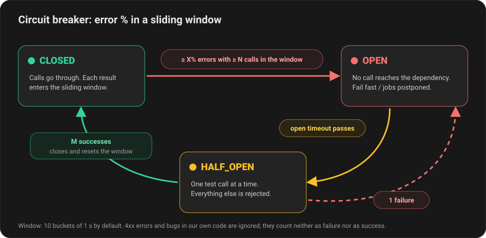

# Circuit Breaker

> [!WARNING]
> **This project was created for didactic purposes only and must not be used
> in production.** Its goal is to exercise the ideas and concepts behind a
> resilient application: circuit breaker, bulkhead, timeouts and fail fast.
>
> The whole setup (Docker, docker-compose, CPU/RAM limits and load tests) was
> used **only to study and measure** how these patterns behave: locally, and in
> the CI pipeline, which builds the image and runs it with the same limits.
> There was never an intention to take it to production, and this README has no
> deployment instructions. For a real project, use a maintained library (see
> [Alternatives](#alternatives)).

A study project that implements the fault tolerance patterns described by
Netflix in [Hystrix](https://netflixtechblog.com/fault-tolerance-in-a-high-volume-distributed-system-91ab4faae74a)
in two paths: asynchronous, with BullMQ workers, and synchronous, inside the
HTTP request:

- **Bulkhead**: each external dependency has its own queue and its own
  concurrency limit, so a slow dependency doesn't use up the workers of the
  others.
- **Circuit breaker**: opens when the error percentage in a sliding window goes
  over the limit, and stops calling the dependency until it recovers.
- **Semaphore** (synchronous path): limits the concurrent calls to each
  dependency and rejects the excess right away.

The dependencies are simulated by mock endpoints in the application itself,
which fail at a configurable percentage (HTTP 500 on calls, 503 on health
checks) and have artificial latency.

## Table of contents

- [How to run](#how-to-run)
- [Configuration](#configuration)
  - [Dependencies (`DEPENDENCIES`)](#dependencies-dependencies)
  - [Circuit breaker](#circuit-breaker-1)
  - [Queues and application](#queues-and-application)
- [How it works](#how-it-works)
  - [Bulkhead: one queue per dependency](#bulkhead-one-queue-per-dependency)
  - [Circuit breaker: error % in a sliding window](#circuit-breaker-error--in-a-sliding-window)
  - [What counts as a failure](#what-counts-as-a-failure)
- [Synchronous calls (`POST /sync/:dependency`)](#synchronous-calls-post-syncdependency)
  - [HALF_OPEN without using a user's request as the test](#half_open-without-using-a-users-request-as-the-test)
  - [In-memory store](#in-memory-store)
  - [Attention: ephemeral environments (AWS Lambda Functions, for instance)](#attention-ephemeral-environments-aws-lambda-functions-for-instance)
  - [Memory or Redis](#memory-or-redis)
- [Docker (local environment for the load tests)](#docker-local-environment-for-the-load-tests)
  - [Docker Image setup](#docker-image-setup)
  - [docker-compose](#docker-compose)
- [Load tests (k6)](#load-tests-k6)
  - [How to run](#how-to-run-1)
  - [Scenarios and results](#scenarios-and-results)
    - [1. `baseline`: healthy dependency](#1-baseline-healthy-dependency)
    - [2. `spike`: traffic spike with a healthy dependency](#2-spike-traffic-spike-with-a-healthy-dependency)
    - [3. `outage`: the dependency goes down in the middle of the load](#3-outage-the-dependency-goes-down-in-the-middle-of-the-load)
    - [4. `slow-dependency`: slow dependency](#4-slow-dependency-slow-dependency)
    - [5. `client-errors`: 4xx don't hide an outage](#5-client-errors-4xx-dont-hide-an-outage)
    - [6. `isolation`: a dependency being down doesn't affect the others](#6-isolation-a-dependency-being-down-doesnt-affect-the-others)
  - [Notes about the test environment](#notes-about-the-test-environment)
- [Structure](#structure)
- [Endpoints](#endpoints)
- [Tests](#tests)
- [Alternatives](#alternatives)

## How to run

With the application running directly on your machine:

```bash
docker compose up -d
npm install
npm run start:dev
```

With the application in a container, with CPU/RAM limits (the setup used in the
load tests), see [Docker](#docker-local-environment-for-the-load-tests):

```bash
docker compose --profile app up -d --build
```

Enqueue jobs and watch them:

```bash
curl -XPOST localhost:3000/jobs/notifications -H 'content-type: application/json' -d '{"count": 30}'
curl -XPOST localhost:3000/jobs/payments -H 'content-type: application/json' -d '{"count": 30}'

curl localhost:3000/circuit-breakers   # state and window of each circuit
curl localhost:3000/mock/stats         # calls received by each mock (including the concurrency peak)
curl localhost:3000/jobs/counts        # jobs per state in each queue
```

Synchronous calls:

```bash
curl -i -XPOST localhost:3000/sync/payments -H 'content-type: application/json' -d '{}'
curl -i -XPOST localhost:3000/sync/payments -H 'content-type: application/json' -d '{"invalid": true}'  # 400
curl localhost:3000/circuit-breakers/payments-sync
```

## Configuration

Everything lives in [`src/config/constants.ts`](src/config/constants.ts).
Some values can be overridden with environment variables:

| Variable | Default | Description |
| --- | --- | --- |
| `PORT` | `3000` | HTTP port (the application also calls its own mocks on it) |
| `REDIS_HOST` / `REDIS_PORT` | `localhost` / `6379` | Redis used by BullMQ and by the Redis circuit store |
| `CIRCUIT_BREAKER_STORE` | `memory` | overrides the constant with the same name |

### Dependencies (`DEPENDENCIES`)

| Dependency | Queue | `concurrency` (queue) | `sync` (peak × p99 → slots) | Mock error rate | Mock latency |
| --- | --- | --- | --- | --- | --- |
| `payments` | `payments-calls` | 2 | 100 req/s × 100 ms → 13 | 60% | 100 ms |
| `notifications` | `notifications-calls` | 5 | 2 req/s × 1500 ms → 4 | 5% | 1500 ms |

`payments` is fast but unstable, and should open the circuit often.
`notifications` is stable but slow. Without the bulkhead, it would use up the
`payments` workers.

To add a dependency, include it in `DEPENDENCIES`, create the matching
processor in `src/processing/dependency-processors.ts` and register it in the
`providers` of `ProcessingModule` (`src/processing/processing.module.ts`). The
queue, the synchronous gateway, the mock and the `:dependency` validation come
from `DEPENDENCIES` automatically.

### Circuit breaker

| Constant | Default | Description |
| --- | --- | --- |
| `CIRCUIT_BREAKER_STORE` | `'memory'` | store for the queue circuits: `'memory'` or `'redis'` (or the `CIRCUIT_BREAKER_STORE` env var) |
| `SYNC_CIRCUIT_BREAKER_STORE` | `'memory'` | store for the synchronous circuits (see [ephemeral environments](#attention-ephemeral-environments-aws-lambda-functions-for-instance)) |
| `SYNC_BULKHEAD_HEADROOM_PERCENT` | `25` | headroom added to the synchronous semaphore slots calculation |
| `CIRCUIT_BREAKER_HEALTH_PROBE_INTERVAL_MS` | `1000` | interval of the background health check while the synchronous circuit is `HALF_OPEN` |
| `CIRCUIT_BREAKER_ERROR_THRESHOLD_PERCENT` | `50` | error % in the window that opens the circuit |
| `CIRCUIT_BREAKER_MINIMUM_REQUESTS` | `10` | minimum volume in the window before the error % is evaluated |
| `CIRCUIT_BREAKER_WINDOW_MS` | `10000` | size of the sliding window |
| `CIRCUIT_BREAKER_WINDOW_BUCKETS` | `10` | buckets in the window (1 s resolution) |
| `CIRCUIT_BREAKER_OPEN_TIMEOUT_MS` | `10000` | time in `OPEN` before going to `HALF_OPEN` |
| `CIRCUIT_BREAKER_HALF_OPEN_SUCCESS_THRESHOLD` | `2` | successes in `HALF_OPEN` needed to close |
| `CIRCUIT_BREAKER_HALF_OPEN_PROBE_LEASE_MS` | `5000` | validity of the test call reservation in `HALF_OPEN` |
| `CIRCUIT_BREAKER_REDIS_KEY_PREFIX` | `'circuit-breaker:'` | prefix of the Redis store keys |
| `EXTERNAL_SERVICE_TIMEOUT_MS` | `2000` | timeout of the HTTP call (counts as a failure) |

### Queues and application

| Constant | Default | Description |
| --- | --- | --- |
| `JOB_ATTEMPTS` | `5` | attempts per job (postponements by an open circuit don't count) |
| `JOB_BACKOFF_DELAY_MS` | `1000` | base delay of the exponential backoff between attempts, and minimum postponement while the circuit is open |
| `JOB_MAX_AGE_MS` | `600000` | maximum age of a job postponed by an open circuit; after that it fails |
| `JOB_POSTPONE_JITTER_MS` | `2000` | random delay added to each postponement, so jobs don't wake up together |
| `JOB_KEEP_COMPLETED` / `JOB_KEEP_FAILED` | `1000` / `5000` | completed and failed jobs kept in Redis per queue |
| `JOBS_MAX_PER_REQUEST` | `1000` | maximum `count` in `POST /jobs/:dependency` |
| `MOCK_MAX_LATENCY_MS` | `60000` | maximum latency accepted by `PUT /mock/:dependency/behavior` |

## How it works

### Bulkhead: one queue per dependency

Hystrix isolates each dependency in a fixed-size thread pool. In Node, I/O
doesn't block threads, so the resource to limit is the number of concurrent
calls. Here, each dependency has:

- **its own queue**, which plays the role of the thread pool queue (but
  persistent);
- **a worker with its own `concurrency`**, which is the size of the "pool": at
  most N concurrent calls to that dependency per process;
- **its own circuit breaker**, with the same name as the dependency.

`GET /mock/stats` shows the `maxInFlight` of each mock. With only queue traffic
and a single instance of the application, it doesn't go above the configured
`concurrency` while the calls finish before the timeout. The counter is shared
with the synchronous path, and a call abandoned at the timeout keeps running on
the mock while the worker takes the next job (see the
[slow dependency scenario](#4-slow-dependency-slow-dependency)).

### Circuit breaker: error % in a sliding window



- **CLOSED**: each result goes into the bucket of the current second. Buckets
  older than the window are discarded. After a failure, if there are at least
  `MINIMUM_REQUESTS` calls in the window and the error % is ≥
  `ERROR_THRESHOLD_PERCENT`, the circuit opens. The minimum volume avoids
  opening on 1 failure out of 1 call.
- **OPEN**: no call reaches the dependency. The processor receives a
  `CircuitOpenError`, moves the job to `delayed` until the circuit can be
  tested again, or for at least `JOB_BACKOFF_DELAY_MS` (in `HALF_OPEN`, while
  another job holds the test call), with `job.moveToDelayed` + `DelayedError`,
  and **does not consume an attempt** of the job. A random delay of up to `JOB_POSTPONE_JITTER_MS` is added to the
  postponement: without it, all postponed jobs would wake up at the same
  instant, only one would become the test call, and the rest would be rejected
  and rescheduled in bulk. A job older than `JOB_MAX_AGE_MS` fails instead of
  being postponed again, so it doesn't wait forever (or run hours later).
- **HALF_OPEN**: one test call at a time. If it fails, back to `OPEN`. After
  `M` successes, it closes and **resets the window**.

Real failures (HTTP 500, timeout) are rethrown and handled by BullMQ's normal
retry. 4xx errors become `UnrecoverableError`: the job fails right away,
because repeating an invalid request doesn't change the result.

### What counts as a failure

Not every error means the dependency is in trouble
(`isDependencyFailure` in `src/external-service/dependency.errors.ts`):

| Error | Counts as a failure? |
| --- | --- |
| HTTP 4xx (400, 401, 404, 422…) | **no**: the request was the one that was wrong |
| HTTP 408 and 429 | yes: they indicate overload in the dependency |
| HTTP 5xx, timeout, network failure | yes |
| Error from our own code (e.g. a `TypeError` while serializing the payload) | **no**: a bug of ours can't open the circuit of a healthy dependency |

Errors that don't count as failures are **ignored** by the circuit: they go
into the window neither as a failure nor as a success (they show up in
`stats.ignored`). Counting them as successes would dilute the error %, and a
client sending invalid requests would keep the circuit closed while the
dependency is down. In `HALF_OPEN`, they only release the test call
reservation.

## Synchronous calls (`POST /sync/:dependency`)

Without a queue, there's nowhere to keep the work for later: with the circuit
open, the response has to go out right away. The `SyncDependencyGateway` plays
the role of Hystrix's `DependencyCommand`:


| Situation | Response |
| --- | --- |
| Success | `200` with the dependency's body |
| Dependency answered 4xx | same status, with the reason given by the dependency |
| Dependency answered 429 | `503` + the `Retry-After` sent by the dependency (minimum 1) |
| Dependency answered 5xx / 408, or network failure | `502 Bad Gateway` |
| Timeout | `504 Gateway Timeout` |
| Circuit open | `503` + `Retry-After` (seconds until `HALF_OPEN`, minimum 1) |
| Semaphore full | `503` + `Retry-After: 1` |

**No retry.** Retrying inside the request only increases the latency of whoever
is waiting and multiplies the load on a dependency that is already in trouble.
The client decides whether to try again, guided by `Retry-After`.

**Semaphore.** It limits the concurrent calls to each dependency, per process.
There is no waiting queue: the excess gets a `503` right away.

The slots are not a fixed number. They are calculated with Little's law from
`DEPENDENCIES[x].sync` (`syncBulkheadSlots` in `src/config/constants.ts`):

```
slots = ⌈ peakRequestsPerSecond × (p99LatencyMs / 1000) × (1 + SYNC_BULKHEAD_HEADROOM_PERCENT / 100) ⌉, minimum 1
```

`payments`: 100 req/s × 0.1 s = 10 concurrent calls at the peak, + 25% = **13
slots**. With this capacity, the expected peak doesn't fill the semaphore while
the dependency is healthy. The peak and p99 values should come from
observability (real metrics), and the peak is **per process**: with 4 instances
behind a load balancer, divide the total peak by 4. The calculated slots show
up in the log when the application starts.

**The semaphore sits outside the circuit breaker**, so being full doesn't count
as a failure:

- *a spike in our own traffic, healthy dependency*: only the excess gets a
  `503`; the circuit stays closed and the rest of the traffic goes on as usual.
  If being full counted, 20 rejections out of 30 requests (66%) would open the
  circuit and take down **all** calls for 10 s, on a working dependency;
- *slow dependency*: the stuck calls hit the timeout, and timeouts count as
  failures and open the circuit.

Hystrix does the opposite (it counts being full), which is only safe with a
well-sized pool. Here the cost of not counting it is reacting to slowness a
little later, after the timeout.

### HALF_OPEN without using a user's request as the test

In the classic model, the first call in `HALF_OPEN` is the test. In the
synchronous path, that call is a real user's request, who gets the error if the
dependency is still down. Here:

- in `HALF_OPEN`, **all** user requests get a `503` right away;
- the `HealthProber` calls `GET /mock/:dependency/health` every
  `CIRCUIT_BREAKER_HEALTH_PROBE_INTERVAL_MS` while the circuit is `HALF_OPEN`,
  and only it can close the circuit (`CIRCUIT_BREAKER_HALF_OPEN_SUCCESS_THRESHOLD`
  health checks in a row) or reopen it. The exception is a manual
  `POST /circuit-breakers/:name/reset`, which forces `CLOSED`.

The cost is that a healthy health check doesn't guarantee the real calls will
work. If they fail after the circuit closes, the window opens it again once it
reaches the minimum volume. That's why the health check should exercise the
same path as the real calls (database, credentials, etc.), and not just answer
"I'm up".

The queue doesn't need this: if the test call fails, the job just goes back to
the queue.

### In-memory store

The synchronous circuits (`<dependency>-sync`) use memory, regardless of
`CIRCUIT_BREAKER_STORE`. This avoids adding 2 round trips to Redis to the
latency of every request, and prevents the whole API from failing if Redis goes
down. They are independent from the queue circuits (`<dependency>`).

### Attention: ephemeral environments (AWS Lambda Functions, for instance)

On AWS Lambda, Cloud Functions, Cloud Run or any platform that scales to zero
or creates one instance per request, **in-memory state doesn't work and an
external storage is needed** (`SYNC_CIRCUIT_BREAKER_STORE = 'redis'`, or
another one such as DynamoDB):

- each cold start begins with a zeroed, `CLOSED` circuit;
- on Lambda, each instance handles one request at a time, so no instance
  accumulates the minimum volume and the circuit **never opens**, while the
  dependency receives the traffic of all the instances;
- the process is frozen between invocations, so the `HealthProber` doesn't run.
  The health check has to come from outside (e.g. a scheduled function that
  writes the result to the shared storage);
- for the same reason, the per-process semaphore limits nothing. The limit has
  to come from the platform (e.g. Lambda's *reserved concurrency*).

### Memory or Redis

The state machine sits behind the `CircuitBreakerStore` interface, with two
implementations. `CircuitBreakerModule.forRoot({ store })` chooses which one to
use.

| | `memory` | `redis` |
| --- | --- | --- |
| State | per process | shared between all workers |
| Cost per call | none | 2 round trips to Redis (before and after) |
| Atomicity | Node's event loop | Lua script (`EVALSHA`) |
| Keys | — | `circuit-breaker:{name}` (state) and `circuit-breaker:{name}:window` (buckets) |

The keys use the name between braces (a *hash tag*) so they land in the same
slot in a Redis Cluster, which is required by scripts with more than one key.
The window key has a TTL equal to the window size, so it disappears by itself
if there is no traffic. Buckets that leave the window are deleted on every
write, so the hash never goes over 2 fields per bucket (without that, traffic
with only successes would make it grow without limit, and the first failure
would block Redis while it walks the whole hash).

With `redis`, when a worker opens the circuit, all the others stop calling the
dependency. In `HALF_OPEN`, only one test call runs at a time in the whole
cluster, and closing takes `CIRCUIT_BREAKER_HALF_OPEN_SUCCESS_THRESHOLD`
successes in a row. If the worker making the test dies, the reservation expires after
`CIRCUIT_BREAKER_HALF_OPEN_PROBE_LEASE_MS` and another worker can try.

To see the shared circuit, start two instances:

```bash
npm run build
CIRCUIT_BREAKER_STORE=redis PORT=3000 node dist/main.js
CIRCUIT_BREAKER_STORE=redis PORT=3001 node dist/main.js
```

`GET /circuit-breakers/payments` returns the same state on both ports.

With the Redis store, each worker uses its own machine's clock to make
time-based decisions, like when the circuit can be tested again, so all servers
need synchronized clocks, for example with the Network Time Protocol (NTP).

## Docker (local environment for the load tests)

The Dockerfile and the docker-compose exist to run the load tests against the
application in a container with limited, predictable resources, on the local
machine. They are not a deployment setup.

### Docker Image setup

Multi-stage build, in four stages:

| Stage | Base | What it does |
| --- | --- | --- |
| `deps` | `node:24-trixie-slim` | `npm ci` with all dependencies (npm cache via BuildKit) |
| `build` | `deps` | compiles the TypeScript (`npm run build`) |
| `prod-deps` | `node:24-trixie-slim` | `npm ci --omit=dev`: runtime dependencies only |
| `runtime` | `gcr.io/distroless/nodejs24-debian13:nonroot` | copies `dist/`, the `node_modules` with the runtime dependencies only, and `package.json` (needed for `"type": "module"`) |

### docker-compose

```bash
docker compose up -d
docker compose --profile app up -d --build
```

The application is in the `app` profile so it doesn't conflict with
`npm run start:dev`. The configuration has limited resources, so the load tests
run against a small, predictable environment:

| | `app` | `redis` |
| --- | --- | --- |
| CPU | 1 core | 0.5 core |
| Memory | 512 MiB, no swap (reservation 256 MiB) | 256 MiB, no swap (`maxmemory 192mb`) |
| Node heap | `--max-old-space-size=384` (~75% of the limit) | — |
| Processes | maximum of 128 | — |
| Filesystem | read-only (`/tmp` in a 16 MB tmpfs) | volume for the AOF |
| Capabilities | all dropped, `no-new-privileges` | — |
| PID 1 | `init: true` (tini forwards signals and reaps zombies) | — |
| Shutdown | `stop_grace_period: 30s` to finish the active jobs | — |
| Ports | only on `127.0.0.1` | only on `127.0.0.1` |
| Healthcheck | `GET /health` | `redis-cli -e ping` (the app only starts with a healthy Redis) |

Redis uses `maxmemory-policy noeviction`, a BullMQ requirement (it can't lose
job keys), and AOF so the queues survive a restart.

**Shutdown without reprocessing jobs.** On SIGTERM, each processor closes its
own worker in the first phase of NestJS's shutdown (`onModuleDestroy`), waiting
for the active jobs to finish while Redis and the dependencies are still
available. The circuit breaker's Redis connection is only closed in the last
phase (`onApplicationShutdown`). Before, `@nestjs/bullmq` only closed the
workers in the last phase, after the circuit breaker's connection: jobs that
had already called the dependency failed to record the result and were
reprocessed, repeating the call.

## Load tests (k6)

Six scenarios in `load-tests/scenarios/`, run against the application in
Docker, with the limits above. Each run generates **k6's own HTML report** in `load-tests/reports/<scenario>.html`, with charts over time, and saves every
k6 sample in `load-tests/reports/<scenario>.samples.csv.gz`, including the
simulated failures and the circuit state sampled every second. From these
samples, `python3 load-tests/charts.py <output directory>` draws per-second
charts by HTTP status and circuit state (outage, slow dependency and spike), from
the saved samples or from your own run. The
k6 output in the terminal shows the final summary and the timeline of the
circuit and of the simulated failure, and `run.sh` adds the peak CPU and memory
of the container during the scenario (measured with `docker stats`).

### How to run

```bash
docker compose --profile app up -d --build
npm run load-test # all scenarios (~6 min)
./load-tests/run.sh outage spike # only some of them
```

Each scenario:
1. **`setup`**: puts the environment in a known state: default mock behavior,
   zeroed counters and a closed circuit.
2. **Failure**: in `outage`, `slow-dependency` and `client-errors`, auxiliary
   k6 scenarios change the error rate or the latency of the mock at set times
   (`PUT /mock/:dependency/behavior`). `isolation` breaks `payments` in
   `setup`, and `baseline` and `spike` have no failure.
3. **Monitor**: a scenario with 1 VU reads the circuit state every second,
   feeds the `circuit_not_closed` metric and logs each transition in the k6
   output.
4. **Thresholds**: they check the expected behavior, not just performance. For
   example: "the open circuit's 503 answers in p95 < 50 ms" and "the circuit
   never opened during the spike". If any of them fails, k6 exits with code 99.
5. **`teardown`**: logs how many calls actually reached the dependency and
   checks the final state of the circuit. These checks are also thresholds, so
   they fail the run too. `isolation` puts `payments` back to its default
   behavior at the end.

### Scenarios and results

Run of 2026-10-08 against the container (Node 24, 1 CPU, 512 MiB). **All the
thresholds passed in the 6 scenarios.** The latencies include the 100 ms
simulated by the mock.

#### 1. `baseline`: healthy dependency

50 req/s for 30 s on `POST /sync/payments`, with 0% errors and 100 ms of
latency.

| Metric | Result |
| --- | --- |
| Requests | 1,500, all `200` (0% failures) |
| p95 / p99 latency | 102.4 ms / 102.8 ms (**~2.4 ms of overhead** over the dependency's 100 ms) |
| Circuit | `CLOSED` 100% of the time |
| Container (peak) | 17% CPU, 84 MiB |

#### 2. `spike`: traffic spike with a healthy dependency

Ramp from 20 → 300 req/s, held for 10 s. The `payments` semaphore has 13
slots, that is, ~130 req/s at 100 ms per call.

| Metric | Result |
| --- | --- |
| Requests | 5,000: 2,722 `200` and 2,278 `503` (semaphore full) |
| `200` p95 latency | 102.0 ms: whoever was served didn't feel the spike |
| `503` p95 latency | **0.37 ms**: the excess is rejected right away |
| Peak concurrent calls on the dependency | **13**, exactly the number of slots |
| Circuit | `CLOSED` 100% of the time: being full doesn't count as a failure |
| Container (peak) | 28% CPU, 86 MiB |

#### 3. `outage`: the dependency goes down in the middle of the load

50 req/s for 60 s. The dependency is down (100% HTTP 500) between 15 s and
35 s.

Timeline (from the circuit monitor):

| Time | Event |
| --- | --- |
| 15 s | dependency goes down |
| 20 s | circuit **opens**, with the window at 468 requests and 50% errors |
| ~30 s | `HALF_OPEN`: the health check fails and the circuit goes back to `OPEN` |
| 35 s | dependency comes back |
| 41 s | `HALF_OPEN`: health check ok |
| 43 s | circuit **closes** (2 health checks ok) |

| Metric | Result |
| --- | --- |
| Requests | 3,001: 1,612 `200`, 239 `502`, 1,150 `503` |
| `503` latency (open circuit) p95 | **0.64 ms**, against ~102 ms for the `502` that reached the dependency |
| Calls that reached the dependency during the outage | 239 failures plus 1 health check (~30 s); the other ~760 never left. The other 2 health checks came after the recovery and closed the circuit |
| Container (peak) | 10% CPU, 87 MiB |

**Takeaways:**
- **The circuit took 5 s to open.** The 10 s window still had the successes
  from before the outage, and it took as many failures as successes to reach
  50%. A smaller window reacts faster but tolerates less oscillation.
- **The circuit stayed open ~8 s after the dependency came back** (from 35 s to
  43 s): that's the cost of the 10 s `OPEN_TIMEOUT`, ~400 requests rejected
  with the dependency already healthy. It's the balance between not hammering
  an unstable dependency and recovering fast.

#### 4. `slow-dependency`: slow dependency

50 req/s for 60 s. Between 15 s and 35 s, the latency goes from 100 ms to 3 s,
above the 2 s timeout.

| Metric | Result |
| --- | --- |
| Requests | 3,001: 1,909 `200`, 65 `504` (timeout), 1,027 `503` |
| Maximum latency | **2 s**, the timeout: nobody waited the dependency's 3 s |
| `503` p95 | 0.82 ms (first from the semaphore being full, then from the open circuit) |
| Circuit | opened 11 s after the slowdown started (only timeouts count; being full doesn't); closed 2 s after the recovery |
| Container (peak) | 20% CPU, 88 MiB |

**Takeaway:** the dependency got to have **26** concurrent calls, with 13
slots. The timeout frees the slot on our side, but the dependency keeps
processing the abandoned request until it finishes. In other words, a timeout
doesn't cancel the work on the other side: with slow dependencies, the real
load on them can go over the semaphore limit.

#### 5. `client-errors`: 4xx don't hide an outage

50 req/s for 55 s, with 80% invalid payloads (`400`) and 20% valid ones. The
dependency goes down between 20 s and 40 s.

| Metric | Result |
| --- | --- |
| Before the outage | circuit `CLOSED`, ~790 `400` responses ignored and **0 failures in the window** |
| During the outage | circuit **opened in 6 s** (window with 81 valid requests and 54.3% errors), even with 80% of the responses being `400` |
| Requests | 2,751: 271 `200`, 1,317 `400`, 46 `502`, 1,117 `503` |
| Container (peak) | 15% CPU, 88 MiB |

If the `400`s counted as successes, the error % would stay at ~20% and the
circuit would never open.

#### 6. `isolation`: a dependency being down doesn't affect the others

Both dependencies are called synchronously, in the same process, at the same
time. `payments` is down for the whole test (40 s, 100% HTTP 500) and receives
30 req/s. `notifications` is healthy (1.5 s latency, 4 slots) and receives
2 req/s. The question is whether the outage of `payments` leaks into
`notifications`.

It shouldn't, because each dependency has its own semaphore and its own
circuit (`payments-sync` and `notifications-sync`): when `payments` fails, only
its own circuit counts the failures and opens. The scenario monitors both
circuits and requires `notifications-sync` to stay `CLOSED` the whole time and
`notifications` to never get a `503` (which would mean its semaphore or its
circuit rejected the call).

| Metric | Result |
| --- | --- |
| `payments` | circuit opened in ~1 s and wasn't `CLOSED` in 97.5% of the samples (`OPEN` in 92.5%, `HALF_OPEN` during the health checks in the rest); 1,188 of 1,201 calls answered `503` with p95 **0.76 ms**, and only 13 reached the dependency |
| `notifications` | circuit `CLOSED` **100% of the time** and **0 `503`**; 75 `200` and 6 `502` (7.4%, the mock's own random errors, configured at 5%), with p95 of 1.5 s, the dependency's own latency |
| Container (peak) | 10% CPU, 87 MiB |

### Notes about the test environment

- **The container's consumption includes the mock.** Each synchronous request
  generates a second HTTP request to the mock, in the same process. With a real
  external dependency, the application's consumption would be lower.
- **The charts include the control calls.** The monitor (1 req/s) and the
  setup/teardown calls show up in the general charts of the HTML report. The
  thresholds and the tables above filter only the measured traffic (by
  scenario).
- **The CPU/memory peak has a resolution of ~2 s**, because each `docker stats`
  takes that long to answer.
- **k6 runs on the same machine.** It is outside the container's limits, but
  competes with the application for the machine's CPU.

## Structure

```
src/
  main.ts, app.module.ts           bootstrap and root module
  common/zod/                      createZodDto and the global ZodValidationPipe
  config/constants.ts              global constants and dependencies
  health/                          GET /health (liveness)
  healthcheck.ts                   Docker HEALTHCHECK script
  circuit-breaker/                 circuit breaker, registry, health prober and status endpoints
    stores/                        in-memory or Redis state (Lua script)
  bulkhead/                        semaphore and slots calculation (Little's law)
  dependencies/dto/                shared DTOs (:dependency and forwarded payload)
  mock-external-service/           endpoints that simulate the dependencies
  external-service/                HTTP client for the dependencies and error classification
  processing/                      queues, processors (one per dependency) and endpoints
  sync/                            synchronous path: gateway, controller and error filter
load-tests/
  lib/api.js                       API calls, mock control and circuit monitor
  scenarios/                       k6 scenarios
  reports/                         k6 HTML reports and raw samples (CSV)
  run.sh                           runs the scenarios and generates the reports
  charts.py                        draws per-second charts from the k6 samples
docs/                              README diagrams
Dockerfile, .dockerignore          application image (used in the load tests)
docker-compose.yml                 Redis (dev), application with limits (app profile) and k6 (load-test profile)
```

## Endpoints

| Method | Route | |
| --- | --- | --- |
| `POST` | `/jobs/:dependency` | enqueues `count` jobs (default 1, max 1000); answers `202` |
| `GET` | `/jobs/counts` | job counts per state in each queue |
| `POST` | `/sync/:dependency` | calls the dependency inside the request |
| `POST` | `/mock/:dependency` | simulated dependency (`{"invalid": true}` → 400) |
| `GET` | `/mock/:dependency/health` | health check of the simulated dependency (same latency and error rate) |
| `PUT` | `/mock/:dependency/behavior` | changes the mock's error rate and latency at runtime |
| `POST` | `/mock/:dependency/reset` | returns the mock to the constants' values and zeroes the counters |
| `GET` | `/health` | application liveness (used by the Docker `HEALTHCHECK`) |
| `GET` | `/mock/stats` | error rate, latency, requests, successes, failures, 400s, health checks and concurrency of each mock |
| `GET` | `/circuit-breakers` | state of all circuits |
| `GET` | `/circuit-breakers/:name` | state of one circuit (`404` if it doesn't exist) |
| `POST` | `/circuit-breakers/:name/reset` | forces the circuit to `CLOSED` (`404` if it doesn't exist) |

An unknown `:dependency` answers `404`, and an invalid body answers `400`.

## Tests

```bash
npm test
```

Docker has to be running: the Redis store and BullMQ tests start their own
Redis with [Testcontainers](https://testcontainers.com/).

## Alternatives

This circuit breaker was built to study the pattern. For a real Node.js
project, use a maintained library instead:

| Library | What it offers |
| --- | --- |
| [**opossum**](https://github.com/nodeshift/opossum) | The most popular circuit breaker for Node.js, maintained by the Red Hat team (nodeshift). Timeout, fallback, error-rate window, half-open state, events for monitoring, and a `capacity` option that works as a semaphore. |
| [**cockatiel**](https://github.com/connor4312/cockatiel) | The closest to Hystrix and resilience4j in Node.js. Circuit breaker, bulkhead, timeout, retry and fallback policies, combined with `wrap()`. Written in TypeScript, with `AbortSignal` support. |
